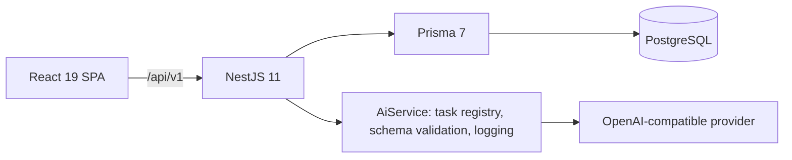

# YÖN

A goal-driven, AI-assisted platform for early-stage founders: tell your startup's story, clarify the goal, get questions written for *your* startup, see where you stand and what is missing, and keep moving.

## Overview

YÖN ("direction" in Turkish) started as a front-end prototype for funding readiness. It has since grown into a full-stack product: a NestJS API on PostgreSQL, a React front end, an AI layer with strict boundaries, a privacy (KVKK) foundation and a documented design system.

The product direction also changed. YÖN is no longer a funding-readiness tool first. It is a **goal-driven** platform: the founder picks or discovers a goal (grants and support programmes, first customers, MVP validation, fundraising, or their own), and the rest of the experience — the questions asked, the gaps shown, the next steps — follows that goal.

**Status:** invite-only beta running on a protected preview environment. The public site (https://yon-dev.vercel.app/) still shows an earlier landing page; the product is not publicly available. There are no usage metrics, and none are claimed.

## Problem

Early-stage founders rarely fail for lack of effort. They fail because they work on the wrong thing for the goal they actually have: preparing a pitch deck when the real gap is talking to customers, or applying to a grant programme without meeting a basic eligibility rule. Generic advice ("improve your pitch") doesn't help. Specific, goal-aware questions and gaps do.

## Product model

```text
Tell → Clarify the goal → Goal-aware interview → Status & gaps → Roadmap → Progress & return
```

| Step | What happens | State |
|---|---|---|
| Tell | The founder describes the startup by form or by chatting with an assistant. The assistant extracts facts as **proposals** the founder accepts or rejects. | ✅ Live (beta) |
| Clarify the goal | Choose a goal pack or write your own. Unsure? A few short questions, or AI suggestions with reasons. | ✅ Live (beta) |
| Goal-aware interview | A deterministic planner picks the most valuable missing fact for the active goal; the AI phrases a question specific to the startup. Each question is stored with *why* it was asked. | ✅ Live (beta) |
| Status & gaps | For fundraising: a 10-question readiness assessment scored on 8 dimensions by fixed rules, with the answers behind each score. Other packs: criteria are being researched. | ◐ Partly live |
| Roadmap | Tasks generated from missing criteria, including the ones the founder didn't think of. | 🔲 Next |
| Progress & return | Re-assessment shows the change since last time; goal history. Periodic check-ins are planned. | ◐ Partly live |

## AI, with boundaries

The AI layer was designed around a few non-negotiable rules:

- **The model never scores.** Readiness scores come from fixed, versioned rules, and goal-pack criteria will too. Module-boundary tests make sure the AI modules cannot reach scoring code.
- **Structured tasks only.** Every model call is a named, versioned task with a strict JSON schema (`profile.extract`, `goal.discover`, `interview.next_question`). Output that doesn't validate is discarded; the flow falls back to fixed templates and never blocks the user.
- **AI content is labelled and traceable.** AI-written suggestions and questions carry a visible label. Interview questions are stored with the field they target, the active goal, the source (AI or template) and the prompt version — while chat messages themselves keep only fixed server text.
- **The founder decides.** Extracted facts are proposals until accepted. Critical facts (e.g. paying customers) can't be accepted from inference alone.
- **Minimal data, explicit consent.** Only the facts needed for a step are sent to the model — never identity data — and only after versioned, explicit consent. Every AI feature has a non-AI alternative.

## Privacy foundation (KVKK)

- Versioned consent records for the privacy notice and for AI features; a stale client version is rejected rather than silently accepted.
- Permanent account deletion in one transaction (leaf-first), plus an admin CLI for support requests.
- 30-day chat retention enforced by query filters, per-startup purging and a scheduled job.
- A data inventory and privacy-notice draft maintained next to the code.

## Architecture



- **Frontend:** React 19, TypeScript, Vite, React Router, Framer Motion; a hand-written design system (tokens, components, dark-mode landing).
- **Backend:** NestJS 11, Prisma 7, PostgreSQL; session cookies, origin checks, rate limits; invite-coded registration for the beta.
- **AI:** provider-agnostic `AiService` (currently an open-weight model behind an OpenAI-compatible API), strict JSON schemas, per-task versions and limits, daily quotas.
- **Hosting:** one Vercel project serving the web app and the API; staging previews run migrations on build; production deploys only through a gated workflow.

## Key technical decisions

**Facts as observations, not fields.** Profile data is stored as an append-only history of observations: source (form, chat), capture method, status (proposed, accepted, rejected, withdrawn), who accepted it and when. Current state is derived. This makes AI proposals, corrections and conflicts explicit instead of overwriting values.

**Planner decides, model phrases.** Which question comes next is a deterministic function of the goal, the profile state and what the founder declined. The model only writes the wording. If the model fails or returns something invalid, a fixed template is used.

**Goals as versioned packs.** A goal pack is versioned content: title, summary, and (next) criteria with sources and task templates. The existing funding assessment became the measurement of the "fundraising" pack instead of the whole product.

**Consent and notice versions as constants on both sides.** The client sends the version it displayed; the server compares. Changing the text forces a new version, and old tabs can't accept new terms by accident.

**One design source of truth.** `DESIGN.md` defines tokens, components, motion and accessibility rules; a signature gradient ("Direction Line") is reserved for AI content and the landing hero, never for scores or statuses.

## Engineering process

Development is done with AI coding agents under my direction. A main session plans, delegates and reviews; sub-agents implement or review specific parts; I make the product decisions and approve every merge. The guardrails that make this work:

- Every change lands on a branch with a PR to `staging`; nothing reaches production without a separate approval.
- Server: lint, build, ~960 unit tests and ~390 end-to-end tests against a throwaway PostgreSQL per run, plus a migration drift check.
- A scripted browser journey (Playwright) walks registration → goal → profile → chat → assessment → result → account deletion against a local AI mock.
- Schema changes, production access and anything touching personal data require explicit owner approval.

## My role

Product owner and sole developer: product direction, scope, design direction and all decisions are mine; I direct the AI agents, review their work and approve what ships.

## Tech stack

- **Frontend:** React 19, TypeScript, Vite, React Router, Framer Motion, Lucide icons, Inter (self-hosted)
- **Backend:** NestJS 11, Prisma 7, PostgreSQL
- **AI:** OpenAI-compatible provider via a provider-agnostic service
- **Testing:** Jest (unit + e2e), Node test runner, Playwright browser journey
- **Infrastructure:** Vercel (web + API services), GitHub Actions

## What's next

- Content for the first goal pack (grants and public support programmes): criteria with official sources and dates, owner-approved.
- Criteria status and a task-based roadmap per goal.
- Periodic check-ins and goal completion.

YÖN does not invest and does not guarantee investment, grants or loans.

Türkçe sürüm: [yon.md](yon.md)
