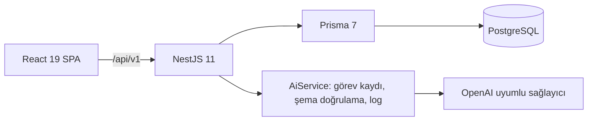

# YÖN

Erken aşama girişimciler için hedef odaklı, yapay zekâ destekli bir platform: girişiminizi anlatın, hedefinizi netleştirin, *sizin* girişiminize göre yazılmış soruları yanıtlayın; nerede durduğunuzu ve neyin eksik olduğunu görün, ilerlemeye devam edin.

## Genel bakış

YÖN, yatırım hazırlığı için bir ön yüz prototipi olarak başladı. Bugün tam yığın bir ürün: PostgreSQL üzerinde NestJS API, React ön yüz, sınırları net çizilmiş bir yapay zekâ katmanı, KVKK altyapısı ve belgelenmiş bir tasarım sistemi.

Ürün yönü de değişti. YÖN artık öncelikle bir yatırım hazırlığı aracı değil, **hedef odaklı** bir platform. Kurucu bir hedef seçer ya da birlikte keşfeder: hibe ve destek programları, ilk müşteri ve satış, ürün / MVP doğrulama, yatırım almak ya da kendi hedefi. Sorulan sorular, gösterilen eksikler ve sonraki adımlar bu hedefe göre şekillenir.

**Durum:** korumalı bir önizleme ortamında çalışan davetli beta. Herkese açık site (https://yon-dev.vercel.app/) henüz önceki tanıtım sayfasını gösteriyor; ürün herkese açık değil. Kullanım verisi yok ve iddia edilmiyor.

## Problem

Erken aşama girişimciler çoğu zaman emek eksikliğinden değil, asıl hedefleri için yanlış şeye odaklandıklarından zorlanır: asıl eksik müşteriyle konuşmakken pitch deck hazırlamak ya da temel bir uygunluk şartını karşılamadan hibe programına başvurmak gibi. "Sunumunu geliştir" gibi genel tavsiyeler işe yaramaz; hedefe özel sorular ve eksikler işe yarar.

## Ürün modeli

```text
Anlat → Hedefi netleştir → Hedefe göre görüşme → Durum ve eksikler → Yol haritası → İlerle ve geri gel
```

| Adım | Ne oluyor | Durum |
|---|---|---|
| Anlat | Kurucu girişimini formla ya da asistanla sohbet ederek anlatır. Asistan bilgileri **öneri** olarak çıkarır; kurucu onaylar ya da reddeder. | ✅ Betada |
| Hedefi netleştir | Hazır bir hedef paketi seçin ya da kendinizinkini yazın. Emin değilseniz birkaç kısa soru ya da gerekçeli yapay zekâ önerileri. | ✅ Betada |
| Hedefe göre görüşme | Deterministik bir planlayıcı aktif hedef için en değerli eksik bilgiyi seçer; yapay zekâ soruyu girişime özel yazar. Her soru *neden sorulduğu* bilgisiyle saklanır. | ✅ Betada |
| Durum ve eksikler | Yatırım hedefinde: 8 boyutta sabit kurallarla puanlanan, her skorun arkasındaki yanıtları gösteren 10 soruluk hazırlık değerlendirmesi. Diğer paketlerin kriterleri araştırılıyor. | ◐ Kısmen |
| Yol haritası | Eksik kriterlerden görevler; kurucunun aklına gelmeyenler dahil. | 🔲 Sırada |
| İlerle ve geri gel | Yeniden değerlendirmede önceki sonuca göre fark; hedef geçmişi. Dönemsel kontroller planlandı. | ◐ Kısmen |

## Sınırları belli yapay zekâ

Yapay zekâ katmanı birkaç değişmez kural etrafında tasarlandı:

- **Model puan vermez.** Hazırlık skorları sabit, sürümlü kurallardan gelir (hedef paketlerinin kriterleri de öyle olacak); modül sınırı testleri yapay zekâ kodunun puanlama koduna erişemediğini doğrular.
- **Yalnızca yapılandırılmış görevler.** Her model çağrısı adı ve sürümü olan, katı JSON şemalı bir görevdir (`profile.extract`, `goal.discover`, `interview.next_question`). Şemaya uymayan çıktı atılır; akış sabit şablonlara düşer, kullanıcı hiç takılmaz.
- **Yapay zekâ içeriği etiketli ve izlenebilir.** Yapay zekânın yazdığı öneri ve sorular görünür biçimde etiketlenir. Görüşme soruları hedeflediği alan, aktif hedef, kaynak (yapay zekâ ya da şablon) ve istem sürümüyle saklanır; sohbet mesajlarının kendisi yalnızca sunucunun sabit metnini taşır.
- **Kararı kurucu verir.** Çıkarılan bilgiler onaylanana kadar öneridir. Kritik bilgiler (ör. ödeme yapan müşteri sayısı) yalnızca çıkarımla kabul edilemez.
- **Az veri, açık rıza.** Modele yalnızca o adım için gereken bilgiler gider, kimlik bilgisi asla gitmez; o da sürümlü açık rızadan sonra. Her yapay zekâ özelliğinin yapay zekâsız bir alternatifi vardır.

## Gizlilik altyapısı (KVKK)

- Aydınlatma metni ve yapay zekâ özellikleri için sürümlü onay kayıtları; eski sürümü gösteren bir istemcinin isteği sessizce kabul edilmez, reddedilir.
- Tek işlemde, kalıcı hesap silme; destek talepleri için yönetici aracı.
- Sorgu filtresi, girişim bazında temizlik ve zamanlanmış görevle uygulanan 30 günlük sohbet saklama süresi.
- Kodun yanında tutulan veri envanteri ve aydınlatma metni taslağı.

## Mimari



- **Ön yüz:** React 19, TypeScript, Vite, React Router, Framer Motion; elle yazılmış tasarım sistemi (token'lar, bileşenler, koyu modlu landing).
- **Arka uç:** NestJS 11, Prisma 7, PostgreSQL; oturum çerezleri, kaynak (origin) denetimi, istek sınırları; beta için davet kodlu kayıt.
- **Yapay zekâ:** sağlayıcıdan bağımsız `AiService` (şu an OpenAI uyumlu bir API arkasında açık ağırlıklı bir model), katı JSON şemaları, görev bazında sürüm ve sınırlar, günlük kota.
- **Barındırma:** web uygulamasını ve API'yi birlikte sunan tek Vercel projesi; staging önizlemeleri build sırasında migration çalıştırır; production yalnızca kapılı bir iş akışıyla güncellenir.

## Temel teknik kararlar

**Alan değil, gözlem.** Profil verisi eklemeli bir gözlem geçmişi olarak saklanır: kaynak (form, sohbet), yakalama yöntemi, durum (önerildi, onaylandı, reddedildi, geri çekildi), kimin ne zaman onayladığı. Güncel durum bu geçmişten türetilir. Böylece yapay zekâ önerileri, düzeltmeler ve çelişkiler değerlerin üzerine yazılmak yerine açıkça görünür.

**Planlayıcı karar verir, model yazar.** Sıradaki sorunun ne olacağı hedefin, profil durumunun ve kurucunun yanıtlamak istemediklerinin deterministik bir fonksiyonudur. Model yalnızca ifadeyi yazar; hata verir ya da geçersiz bir şey dönerse sabit şablon kullanılır.

**Sürümlü hedef paketleri.** Hedef paketi sürümlü bir içeriktir: başlık, özet ve (sırada) kaynaklı kriterler ile görev şablonları. Mevcut yatırım hazırlığı değerlendirmesi ürünün tamamı olmaktan çıkıp "yatırım almak" paketinin ölçümü oldu.

**Rıza ve metin sürümleri iki tarafta sabit.** İstemci gösterdiği sürümü gönderir, sunucu karşılaştırır. Metin değişince sürüm değişir; eski bir sekme yeni şartları yanlışlıkla kabul edemez.

**Tek tasarım kaynağı.** `DESIGN.md` token'ları, bileşenleri, hareketi ve erişilebilirlik kurallarını tanımlar. İmza gradyanı ("Yön Çizgisi") yalnızca yapay zekâ içeriğine ve landing hero'suna ayrılmıştır; skorlarda ve durumlarda kullanılmaz.

## Geliştirme süreci

Geliştirme, benim yönetimimde yapay zekâ kodlama ajanlarıyla yapılıyor. Ana oturum plan yapar, iş dağıtır ve inceler; alt ajanlar belirli parçaları uygular ya da inceler. Ürün kararlarını ben veririm ve her birleştirmeyi ben onaylarım. Bu düzeni güvenilir kılan kurallar:

- Her değişiklik ayrı bir dalda, `staging`'e PR olarak gelir; ayrı onay olmadan hiçbir şey production'a gitmez.
- Sunucu: lint, build, ~960 birim testi ve her çalıştırmada geçici bir PostgreSQL üzerinde ~390 uçtan uca test; migration farkı denetimi.
- Betikli bir tarayıcı yolculuğu (Playwright) yerel bir yapay zekâ taklidiyle kayıt → hedef → profil → sohbet → değerlendirme → sonuç → hesap silme akışını baştan sona dener.
- Şema değişiklikleri, production erişimi ve kişisel veriye dokunan her şey açık onay gerektirir.

## Rolüm

Ürün sahibi ve tek geliştirici: ürün yönü, kapsam, tasarım yönü ve tüm kararlar bana ait; yapay zekâ ajanlarını yönetir, işlerini inceler ve yayına çıkanı onaylarım.

## Teknoloji yığını

- **Ön yüz:** React 19, TypeScript, Vite, React Router, Framer Motion, Lucide ikonları, Inter (kendi sunucumuzdan)
- **Arka uç:** NestJS 11, Prisma 7, PostgreSQL
- **Yapay zekâ:** sağlayıcıdan bağımsız servis üzerinden OpenAI uyumlu sağlayıcı
- **Test:** Jest (birim + uçtan uca), Node test çalıştırıcı, Playwright tarayıcı yolculuğu
- **Altyapı:** Vercel (web + API servisleri), GitHub Actions

## Sırada ne var

- İlk hedef paketinin içeriği (hibe ve destek programları): resmî kaynaklı ve tarihli, ürün sahibince onaylanmış kriterler.
- Hedef bazında kriter durumu ve görev tabanlı yol haritası.
- Dönemsel kontroller ve hedef tamamlama.

YÖN yatırım yapmaz; yatırım, hibe ya da kredi garantisi vermez.

English version: [README.md](README.md)
